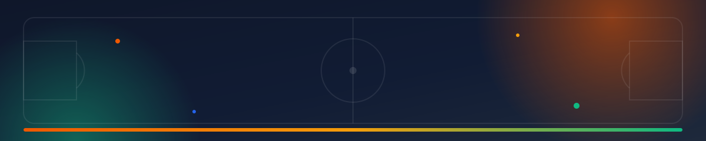
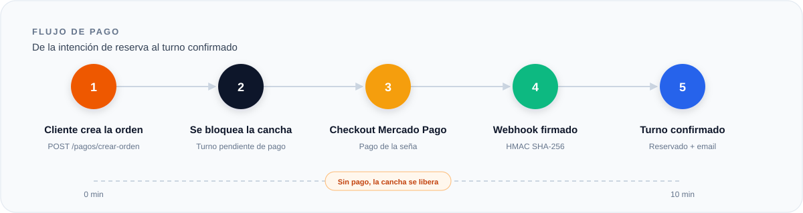
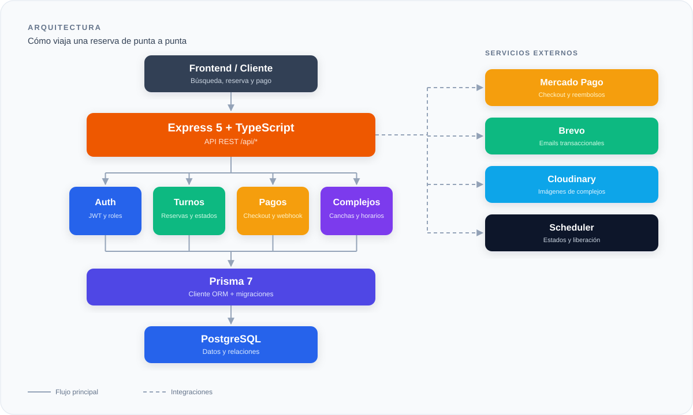

<p align="center">
  
</p>

<p align="center">
  
</p>

<h1 align="center">Turno Libre</h1>

<p align="center">
  <b>Reservas deportivas sin fricción.</b><br />
  La API que conecta complejos, canchas, pagos y personas.
</p>

<p align="center">
  
  
  
  
</p>

<p align="center">
  
</p>

## 01 · Qué es esto

Turno Libre es la API REST que sostiene una plataforma de reservas para complejos deportivos. Recibe pedidos de disponibilidad, bloquea canchas, cobra señas, confirma pagos y libera turnos cuando el pago no llega.

No es un CRUD con pretensiones. Es un sistema con reglas de negocio reales: búsqueda con disponibilidad, horarios en zona horaria argentina, pagos con webhook firmado, reembolsos automáticos, emails transaccionales y métricas para el dueño del complejo.

El objetivo es simple: que un complejo deje de administrar turnos con un cuaderno y una birome.

### Roles

| Rol | Alcance |
| --- | --- |
| Administrador | Gestiona usuarios, personas, complejos y canchas. |
| Encargado | Agenda turnos, consulta clientes y opera su complejo. |
| Cliente | Busca, reserva, paga, consulta y cancela sus turnos. |
| Dueño | Configura complejo, horarios, canchas y precios; ve métricas. |

## 02 · Capacidades

| | |
| :--- | :--- |
|  | Búsqueda por ciudad, deporte, fecha, hora y precio, con grilla de disponibilidad por cancha. |
|  | Turnos con seña, bloqueo temporal y liberación automática si el pago no llega. |
|  | Checkout de Mercado Pago, webhook firmado y reembolso ante solapamientos. |
|  | Recuperación de contraseña, comprobantes de reserva y avisos de contacto. |
|  | Ocupación, ingresos estimados, capacidad y deporte estrella del día. |
|  | Carga validada de fotos de complejos con almacenamiento en Cloudinary. |
|  | Reseñas públicas por complejo, ordenadas por fecha. |
|  | Roles, validación con Zod, JWT, CORS y firma HMAC en webhooks. |

## 03 · Cómo funciona

<p align="center">
  
</p>

1. El cliente elige complejo, cancha, fecha y hora.
2. El backend verifica disponibilidad y crea un turno pendiente de pago.
3. Se genera el checkout de Mercado Pago por el monto de la seña.
4. El webhook firmado confirma el pago y el turno pasa a reservado.
5. Se envía el comprobante por email. Si no hay pago en 10 minutos, la cancha se libera.

## 04 · Stack

| Capa | Tecnologías |
| --- | --- |
| Runtime |    |
| Datos |    |
| Servicios |    |
| Seguridad |   |
| Calidad |   |

## 05 · Arquitectura

<p align="center">
  
</p>

<details>
<summary><b>Ver estructura de carpetas</b></summary>

```text
backend/
├─ assets/
├─ prisma/
│  ├─ schema.prisma
│  ├─ seed.ts
│  └─ migrations/
├─ src/
│  ├─ app.ts
│  ├─ index.ts
│  ├─ auth/
│  ├─ usuario/
│  ├─ complejo/
│  ├─ cancha/
│  ├─ horario/
│  ├─ precio/
│  ├─ turno/
│  ├─ pago/
│  ├─ opinion/
│  ├─ personaFisica/
│  ├─ personaJuridica/
│  ├─ provincia/
│  ├─ localidad/
│  ├─ tipoUsuario/
│  ├─ tipoCancha/
│  ├─ tipoTurno/
│  ├─ contacto/
│  ├─ menues/
│  ├─ email/
│  ├─ config/
│  ├─ middleware/
│  ├─ shared/
│  └─ types/
├─ package.json
├─ tsconfig.json
├─ vitest.config.ts
└─ prisma.config.ts
```

</details>

Cada módulo sigue la misma estructura: `routes` define el camino, `controller` atiende la petición, `service` ejecuta la lógica y `schema` valida los datos.

## 06 · Empezar

### Requisitos

- Node.js 20 o superior.
- PostgreSQL 14 o superior.
- Credenciales de Mercado Pago.
- API key de Brevo.
- Cuenta de Cloudinary.

### Arranque

```bash
git clone https://github.com/MateoSr/backend.git
cd backend
npm install
npx prisma migrate dev
npx prisma db seed
npm run dev
```

Creá un archivo `.env` en la raíz con las credenciales de tu entorno. Por seguridad, este README no lista claves ni valores.

El servidor arranca por defecto en `http://localhost:3000`. La ruta `GET /` responde `Hello, World!` para confirmar que está en línea.

## 07 · API

URL base: `http://localhost:3000/api`

### Autenticación

| Método | Ruta | Acceso | Descripción |
| --- | --- | --- | --- |
| POST | `/login` | Público | Devuelve un JWT con email y contraseña |
| POST | `/register` | Público | Registra un cliente con sus datos personales |
| POST | `/forgot` | Público | Envía el mail de recuperación |
| PATCH | `/reset-password` | Público | Cambia la contraseña usando el token |

### Usuarios

| Método | Ruta | Acceso | Descripción |
| --- | --- | --- | --- |
| GET | `/users/perfil` | Autenticado | Perfil completo del usuario |
| PUT | `/users/perfil` | Autenticado | Edita el perfil propio |
| GET | `/users/clientes` | Encargado | Lista de clientes |
| GET | `/users` | Administrador | Lista todos los usuarios |
| GET | `/users/:id` | Administrador | Obtiene un usuario |
| POST | `/users` | Administrador | Crea un usuario |
| PUT | `/users/:id` | Administrador | Modifica un usuario |
| DELETE | `/users/:id` | Administrador | Elimina un usuario |

### Complejos

| Método | Ruta | Acceso | Descripción |
| --- | --- | --- | --- |
| GET | `/complejos/busqueda` | Público | Búsqueda con filtros y disponibilidad |
| GET | `/complejos/:id` | Público | Detalle con localidad, horarios, opiniones, canchas y precios |
| GET | `/complejos/:id/disponibilidad` | Público | Grilla de disponibilidad por fecha |
| GET | `/complejos` | Administrador | Lista todos los complejos |
| POST | `/complejos` | Administrador | Crea un complejo (acepta imagen base64) |
| PUT | `/complejos/:id` | Dueño | Modifica un complejo |
| PATCH | `/complejos/:id/baja` | Administrador | Pasa el complejo a `Inactivo` |
| DELETE | `/complejos/:id` | Administrador | Elimina un complejo |
| GET | `/complejos/encargado` | Encargado | Complejo asignado al encargado |
| GET | `/complejos/dueno` | Dueño | Complejos del dueño con deportes únicos |

### Horarios, canchas y precios

| Método | Ruta | Acceso | Descripción |
| --- | --- | --- | --- |
| GET | `/complejos/:id/horarios` | Público | Horarios del complejo |
| GET | `/complejos/:id/horarios/:num_dia` | Público | Horario de un día |
| POST | `/complejos/:id/horarios` | Dueño | Crea un horario |
| PUT | `/complejos/:id/horarios/:num_dia` | Dueño | Modifica un horario |
| DELETE | `/complejos/:id/horarios/:num_dia` | Dueño | Elimina un horario |
| GET | `/complejos/:id/canchas` | Público | Canchas del complejo |
| GET | `/complejos/:id/canchas/:nro` | Público | Detalle de una cancha |
| POST | `/complejos/:id/canchas` | Dueño | Crea una cancha |
| PUT | `/complejos/:id/canchas/:nro` | Dueño | Modifica una cancha |
| DELETE | `/complejos/:id/canchas/:nro` | Dueño | Elimina una cancha |
| GET | `/complejos/:id/canchas/:nro/precios` | Público | Historial de precios |
| GET | `/complejos/:id/canchas/:nro/precios/:fechaDesde` | Público | Precio de una fecha |
| POST | `/complejos/:id/canchas/:nro/precios` | Dueño | Crea un precio |

### Turnos

| Método | Ruta | Acceso | Descripción |
| --- | --- | --- | --- |
| GET | `/turnos` | Autenticado | Turnos del usuario autenticado |
| GET | `/turnos/:id` | Autenticado | Detalle de un turno |
| GET | `/turnos/complejo/:id` | Dueño / Encargado | Turnos de un complejo |
| POST | `/turnos` | Cliente | Crea una reserva |
| POST | `/turnos/encargado` | Encargado | Agenda un turno para un solicitante |
| PUT | `/turnos/:id` | Administrador / Encargado | Modifica un turno |
| DELETE | `/turnos/:id` | Administrador | Elimina un turno |
| PATCH | `/turnos/:id/cancelar` | Cliente | Cancela un turno |

### Pagos

| Método | Ruta | Acceso | Descripción |
| --- | --- | --- | --- |
| POST | `/pagos/crear-orden` | Autenticado | Crea la orden y devuelve el checkout |
| POST | `/pagos/webhook` | Público (firmado) | Recibe las notificaciones de Mercado Pago |
| GET | `/pagos/estado/:externalReference` | Autenticado | Consulta el estado de una orden propia |

<details>
<summary><b>Catálogos, opiniones y utilidades</b></summary>

| Método | Ruta | Acceso | Descripción |
| --- | --- | --- | --- |
| GET | `/provincias` | Público | Lista de provincias |
| GET | `/provincias/:id` | Público | Detalle de una provincia |
| GET | `/provincias/:id/localidades` | Público | Localidades de una provincia |
| GET | `/localidad` | Público | Lista de localidades |
| GET | `/localidad/:id` | Público | Detalle de una localidad |
| GET | `/tipoUsuario` | Público | Tipos de usuario |
| GET | `/tipoUsuario/:id` | Público | Detalle de un tipo de usuario |
| GET | `/tipoCancha` | Público | Tipos de cancha y duración |
| GET | `/tipoCancha/:id` | Público | Detalle de un tipo de cancha |
| GET | `/tipoTurno` | Público | Tipos de turno |
| GET | `/tipoTurno/:id` | Público | Detalle de un tipo de turno |
| GET | `/personaFisica` | Administrador | Lista de personas físicas |
| GET | `/personaFisica/:dni` | Administrador | Detalle por DNI |
| POST | `/personaFisica` | Administrador | Crea una persona física |
| PUT | `/personaFisica/:dni` | Administrador | Modifica una persona física |
| DELETE | `/personaFisica/:dni` | Administrador | Elimina una persona física |
| GET | `/personaJuridica` | Administrador | Lista de personas jurídicas |
| GET | `/personaJuridica/:cuit` | Administrador | Detalle por CUIT |
| POST | `/personaJuridica` | Administrador | Crea una persona jurídica |
| PUT | `/personaJuridica/:cuit` | Administrador | Modifica una persona jurídica |
| DELETE | `/personaJuridica/:cuit` | Administrador | Elimina una persona jurídica |
| POST | `/complejos/:id/opiniones` | Público | Deja una opinión sobre un complejo |
| POST | `/contacto` | Público | Envía una solicitud de contratación |
| GET | `/menues/dueno` | Dueño | Métricas del panel del dueño |

</details>

## 08 · Pagos

El webhook de Mercado Pago se valida con HMAC SHA-256 y comparación en tiempo constante. Después se consulta la orden real contra la API de Mercado Pago y se actúa según el estado:

| Estado recibido | Acción |
| --- | --- |
| `processed` / `accredited` | Turno a `Reservado`, orden a `aprobada`, comprobante por mail |
| `canceled` / `cancelled` | Se borra el turno y la orden queda `cancelada` |
| `expired` | Se borra el turno y la orden queda `expirada` |
| `failed` | Se borra el turno y la orden queda `rechazada` con el motivo |
| Solapamiento al acreditar | Se borra el turno, se marca `reembolsada` y se solicita el reembolso |

Si el pago no aparece en 10 minutos, el turno se libera y la orden queda `expirada`. Si el horario se ocupó mientras se pagaba, se reembolsa automáticamente.

## 09 · Automatización

Al arrancar el servidor se encienden dos tareas:

| Tarea | Frecuencia | Función |
| --- | --- | --- |
| Actualización de estados | Cada 10 minutos | Pasa a `En curso` los turnos que empezaron y a `Finalizado` los que terminaron |
| Liberación de pendientes | Cada 60 segundos | Elimina turnos con orden `pendiente` de más de 10 minutos y marca la orden como `expirada` |

Los estados finales (`Cancelado`, `Cancelada`, `Finalizado`, `Finalizada`) nunca se pisan. El sistema solo avanza hacia adelante.

## 10 · Calidad

Los tests corren con Vitest y Supertest, sin depender de una base de datos real ni de servicios externos.

| Archivo | Tipo | Cobertura |
| --- | --- | --- |
| `src/auth.test.ts` | Integración | Login completo por ruta, controlador y servicio |
| `src/schema.test.ts` | Unitario | Validación de usuarios con Zod |
| `src/turno/turno.service.test.ts` | Unitario | Regla de negocio de cancelación de turnos |
| `src/shared/jwt.test.ts` | Unitario | Emisión y verificación de tokens |

```bash
npm test
npm run test:coverage
```

## 11 · Datos demo

El seed deja el sistema listo para probar. Todos los usuarios usan la contraseña `password123`.

| Email | Rol |
| --- | --- |
| `admin@turnolibre.com` | Administrador |
| `dueno1@turnolibre.com` | Dueño |
| `dueno2@turnolibre.com` | Dueño |
| `encargado1@turnolibre.com` | Encargado |
| `encargado2@turnolibre.com` | Encargado |
| `cliente1@gmail.com` | Cliente |

También carga 4 tipos de usuario, 10 tipos de cancha, 3 tipos de turno, 24 provincias, 120 localidades y 2 complejos con horarios, canchas, precios, opiniones y turnos de ejemplo.

## 12 · Seguridad

- Las contraseñas se guardan con bcrypt, nunca en texto plano.
- Los tokens de sesión y de recuperación usan secretos distintos.
- Los JWT se verifican siempre con el algoritmo `HS256`.
- Los roles se validan en el backend, no en el frontend.
- Los datos de entrada se validan con Zod antes de tocar la base.
- El webhook de Mercado Pago exige firma HMAC y comparación en tiempo constante.
- CORS solo permite el frontend configurado y los orígenes locales de desarrollo.
- Las imágenes se validan por tipo y tamaño antes de subirse a Cloudinary.
- El archivo de configuración local está fuera del repositorio.

  ---

## 🔗 Enlaces

- [Repositorio frontend](https://github.com/MateoSr/frontend)
- [Repositorio backend](https://github.com/MateoSr/backend)
- [Pull Request del frontend](https://github.com/MateoSr/backend/pull/1)

---

<p align="center">
  
</p>

<p align="center">
  <b>La pelota no se mancha, los apuntes si.</b>
</p>
